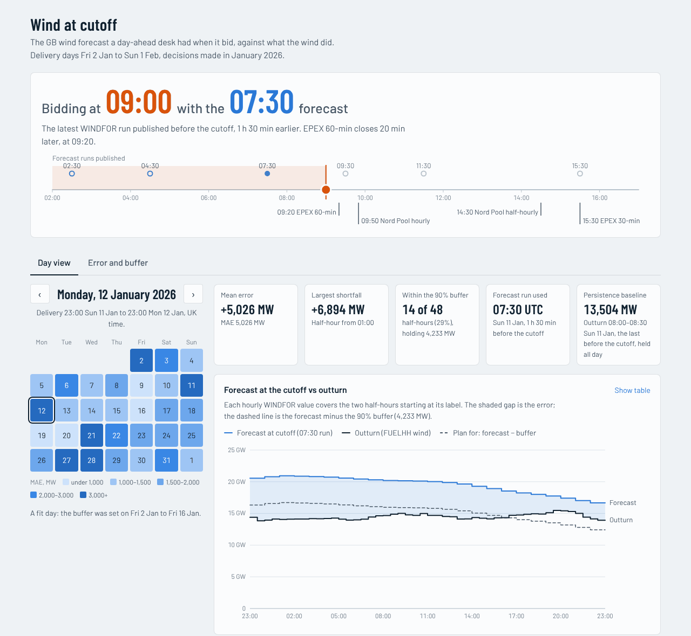
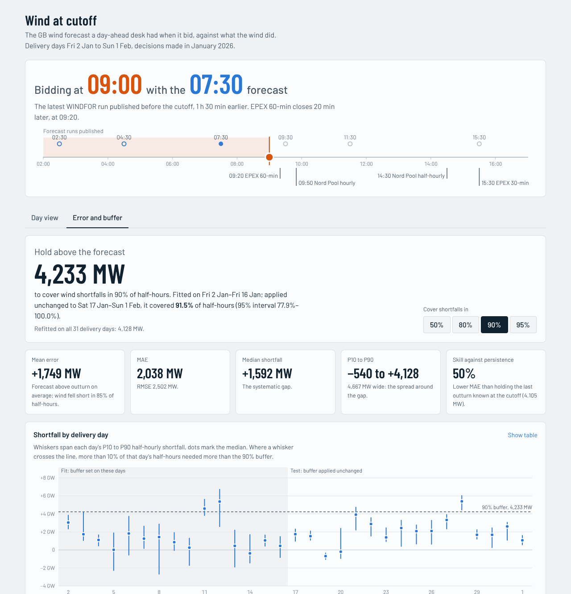

# Wind at cutoff

The GB wind forecast a day-ahead trading desk had when its bid went in, set against what the wind delivered, for
purchase decisions made in January 2026. Data: Elexon Insights WINDFOR (wind generation forecast) and FUELHH
(half-hourly generation outturn, fuel type WIND), nothing else.

**App:** https://rtyfgj.vercel.app (opens on the day view; the second tab is the error and buffer view. The first
request after a quiet spell can take a few seconds while the container starts.)

**Headline, 09:00 UK cutoff on the day before delivery.** The forecast in use ran **1,749 MW above outturn on
average** (MAE 2,038 MW, RMSE 2,502 MW); wind fell short of it in 85% of half-hours. A buffer of **4,233 MW** held
above the forecast-implied volume, sized to cover 90% of half-hours on delivery days 2–16 January, covered **91.5%**
when applied unchanged to 17 January–1 February (95% interval 77.9%–100%). The forecast's MAE is 50% lower than
persistence. Full numbers: [docs/analysis.md](docs/analysis.md). Checks:
[docs/validation.md](docs/validation.md).

| Day view: forecast at the cutoff against outturn | Error and buffer view |
| --- | --- |
|  |  |

## Quick start

```bash
docker compose up --build          # http://localhost:8000
```

Without Docker (Python 3.12 with [uv](https://docs.astral.sh/uv/), Node 22):

```bash
make setup     # uv sync + npm ci
make run       # builds the frontend and serves everything from FastAPI on http://localhost:8000
make dev-api   # API with reload on :8000; in another shell `make dev-web` for Vite on :5173 (proxies /api)
```

Checks: `make test` (lint, types, tests), `make ci` (every CI step except the image build, via
`scripts/ci_local.sh`), `make e2e` (Playwright smoke test against `BASE_URL`, default `http://127.0.0.1:8000`).

Re-run ingestion: `make ingest` downloads the snapshot window from Elexon again into `data/ingest_check/` and compares
SHA-256 hashes with the committed manifest. `make precompute report validate` rebuilds the served tables and both
generated documents from the snapshot. `make help` lists every target.

## What is in the repository

| Path | Contents |
| --- | --- |
| `data/snapshot/` | Raw API responses saved byte-for-byte: WINDFOR stream by publishTime 30 Dec 2025–2 Feb 2026 (19,856 rows, 272 runs), FUELHH WIND by settlement date 31 Dec 2025–2 Feb 2026 (1,632 half-hours), and `manifest.json` (URLs, parameters, download time, row counts, SHA-256). |
| `data/derived/` | The tables the API serves, generated from the snapshot by `windcast precompute`: one file per cutoff (03:00–16:00 in 30-minute steps) for each alignment, outturn by delivery day, the all-vintage analysis and study metadata. CI fails if they differ from a fresh rebuild. |
| `backend/src/windcast/` | Python package. `selection.py` is the core rule; `selection_asof.py` holds the pandas and DuckDB cross-check implementations; `snapshot.py` and `contracts.py` load and check the data; `timeutils.py` the UK-time conventions; `evaluation.py`, `metrics.py` and `analysis.py` compute accuracy, persistence skill, the buffer back-test and the lag scan; `precompute.py` writes `data/derived`; `api.py` and `schemas.py` are the FastAPI app; `report.py` and `validation.py` write the docs; `ingest.py` is the re-runnable download; `cli.py` wires them up. |
| `backend/tests/` | 126 tests: Hypothesis properties of the selection rule, a hand-checked golden day, three-way equivalence (pure Python, pandas `merge_asof`, DuckDB `ASOF JOIN`) on random inputs and on the snapshot, data contracts, UK-time edge cases, analysis on synthetic data, API contract and end-to-end tests. |
| `frontend/` | React 19 + TypeScript (Vite). `src/components/` holds the decision timeline and the two views, `src/charts/` the SVG charts, `src/api/` the client and the types generated from the OpenAPI schema. `src/App.test.tsx` runs the app against real API responses in `src/test/fixtures/` (a backend test fails if they drift); `e2e/smoke.spec.ts` is the Playwright smoke test. |
| `docs/` | `analysis.md` (generated accuracy report), `validation.md` (generated checklist), `data-memo.md` (the pre-build data memo), `time-plan.md`, screenshots in `img/`. |
| `validation/` | Validation-only evidence, never read by the app: NESO's day-ahead wind forecast archive and published metric, values read back from Elexon for 20 random periods, and `manual_checks.json` for checks that need the outside world. Each folder has a manifest with URLs, timestamps and hashes. |
| `scripts/ci_local.sh` | Runs every CI step except the image build. |
| `Dockerfile`, `docker-compose.yml`, `vercel.json`, `heroku.yml` | Three-stage image (React build; locked Python environment that re-derives the served tables, so the build fails if a data contract breaks; slim non-root runtime). `vercel.json` runs that Dockerfile on Vercel's container runtime; `heroku.yml` is a fallback host. |
| `.github/workflows/` | `ci.yml`: backend, frontend, then image build with a Playwright smoke test against the running container. `smoke-deployed.yml`: the same smoke test against the live app after each production deployment, on demand and daily. |

## How it works

```
Elexon API ──windcast ingest──▶ data/snapshot (raw bytes + SHA-256 manifest)
                                     │  data contracts: hashes, schema, keys, hourly runs, gaps,
                                     │  settlement-period mapping, window coverage
                                     ▼
                              windcast precompute ──▶ data/derived/*.json  (deterministic; rebuilt and compared in CI)
                                     │
                              FastAPI /api/v1 (read-only) ──▶ React app: cutoff, delivery day, error and buffer
```

The deployed app serves the committed snapshot; nothing calls Elexon at request time, so every number on screen can
be traced to a file and a hash. The core rule is one pure function, `select_forecasts` in
`backend/src/windcast/selection.py`: for each half-hour delivery period, take the hourly WINDFOR value that covers it
from the latest run published **strictly before** the cutoff, ignoring rows whose target hour starts before their own
publishTime. It is a rule, not "the 07:30 run": 15 January's 11:30 run never arrived, so bidding at 12:00 for the 16th
falls back to the 09:30 run, and from 12:30 the late run published at 12:25 takes over.

API (OpenAPI docs at `/api/docs` on any running copy):

| Endpoint | Returns |
| --- | --- |
| `GET /api/v1/meta` | Delivery days, selectable cutoffs, decision-timeline markers, run schedule and gaps, snapshot provenance |
| `GET /api/v1/days/{date}?cutoff=09:00&coverage=90` | Each half-hour of one delivery day: forecast at the cutoff, outturn, error, run used, lead time, settlement period, buffer coverage |
| `GET /api/v1/accuracy?cutoff=09:00` | Error statistics, breakdowns by lead time and forecast level, persistence skill, buffer back-test, lag scan, per-day summaries |
| `GET /api/v1/vintages` | Errors across every forecast run, separating lead time from hour of day |
| `GET /api/health` | Status, version, alignment, snapshot hashes |

## Decision log

| Decision | Why | Alternatives considered |
| --- | --- | --- |
| Forecast used = latest run with publishTime strictly before the cutoff, chosen per half-hour | A forecast published at the cutoff minute cannot inform a bid; a rule rather than a fixed slot falls back automatically when a run is late or missing | "At or before" the cutoff; a fixed run slot |
| Default cutoff 09:00 UK on D−1, adjustable 03:00–16:00 in 30-minute steps; the run in use is always shown | 20 minutes before EPEX's 09:20 gate closure, so it serves both hourly auctions (Nord Pool's closes at 09:50); from 03:00 the 02:30 run covers the whole delivery day | One cutoff per auction; cutoff at a gate closure |
| Delivery day 23:00–23:00 UK, fixed | Nord Pool's documented GB convention (day-ahead market regulations §2.2.6) | 00:00–24:00 settlement day |
| An hourly value labelled H covers half-hours H and H+30; a −30 min shift is available as configuration (`WINDCAST_ALIGNMENT_SHIFT_MINUTES=-30`) | The field is called startTime, and Elexon's own forecast-history endpoint labels it with the settlement period starting at H. The shifted mapping lowers MAE by only 1.7% (2,038 → 2,004 MW at 09:00), not enough to override the field's meaning | Value centred on the label; averaging outturn to hours |
| Drop WINDFOR rows whose startTime precedes publishTime | 4,081 of 19,856 rows (20.6%). Once an hour has started, later runs repeat a frozen value for it, and that value differs from the last real forecast in 739 of 812 hours | Keep them as nowcasts |
| Actual = FUELHH WIND as published; no curtailment adjustment and no bias-corrected forecast | The brief specifies FUELHH, and separating curtailment needs balancing-mechanism data the brief excludes. Mean error is shown next to MAE and errors are broken down by forecast level, so the systematic gap (median) and the spread (P10–P90) stay visible | Bias-correct; add back curtailed volume |
| Error = forecast − outturn (positive = wind came in short) | That sign is the volume the desk has to cover | Outturn − forecast |
| Buffer = the target quantile of half-hourly shortfall, fitted on delivery days 2–16 Jan, tested on 17 Jan–1 Feb, interval from resampling whole days | Settlement is half-hourly; a time split is the honest out-of-sample test with one month; half-hours within a day are correlated, so days are resampled, not half-hours | Random split; hourly unit; level-dependent buffer |
| Persistence = last outturn published before the cutoff, held for the delivery day | The forecast a desk could make without WINDFOR, using only data it had | Climatology (needs data outside the window) |
| Lead-time errors also computed over every run, not just the run at the cutoff | With one cutoff a day, lead time and hour of day move together; all 28,766 run × half-hour pairs separate them | Decision-time table only |
| Lag scan reported exactly as specified (it fails) plus a proposed criterion | See [Problems with the plan](#problems-with-the-plan) | Reporting only the criterion that passes |
| NESO comparison uses the 09:30 UTC run, and lives in validation only | NESO scores the forecast published 09:00–10:00; the app keeps the 09:00 default | Comparing the 09:00-cutoff forecast |
| Ingest, transform and analysis use only the standard library; the API needs FastAPI only; pandas and DuckDB appear only as test oracles | Small runtime image, no numerical-library drift in the served numbers, two independent cross-checks of the core rule | pandas throughout |
| Precompute every cutoff and both alignments at build time | 27 cutoffs × 2 alignments × 1,488 periods is small; responses become static, cacheable (ETag, CDN) and identical everywhere | Compute per request |
| Deploy the Docker image on Vercel's container runtime | Vercel was the chosen host, and its container runtime builds the same Dockerfile CI tests, so the deployed app is the same stack as `docker compose up` | Python runtime plus static frontend (a second, untested build path); Heroku (`heroku.yml` kept as fallback) |

## Assumptions

Where the brief was ambiguous, these defaults apply:

- "Purchase decisions made in January 2026" means decision days 1–31 January, so delivery days 2 January–1 February:
  2026-01-01 23:00 to 2026-02-01 23:00 UTC, 1,488 half-hours. UK time equals UTC throughout, so no clock change.
- "Latest forecast available at bidding time" means the latest run at the cutoff, and publishTime is when a run became
  available to the desk. The 15 January delays seen in both datasets are consistent with that.
- The desk bids once per delivery day, so one cutoff applies to every half-hour of that day.
- Error is measured per half-hour settlement period; each hourly forecast value applies to two half-hours, with no
  interpolation.
- FUELHH generation is the average MW over each settlement period (Elexon API documentation).
- Gate closure times on the decision timeline (EPEX 60-min 09:20, Nord Pool hourly 09:50, Nord Pool half-hourly 14:30,
  EPEX 30-min 15:30) come from the exchanges' documents, not the data, and are for orientation only. Nord Pool's
  specification is dated April 2023; that the times still applied in January 2026 is unverified.
- The buffer is a volume held above the forecast-implied wind (bought from other sources), not a forecast correction.
- The snapshot is fixed; the deployed app does not refresh from Elexon.

## Limitations

- **Curtailment.** FUELHH is metered output after any curtailment. The gap grows with the forecast level (median
  shortfall +1,144 MW below 6 GW, +3,341 MW at 18 GW and above) and is largest at night, while outturn never exceeded
  17.8 GW in the month although forecasts reached 21.1 GW. That is consistent with curtailment (unverified). If it is
  curtailment, the buffer may overstate the desk's need at high wind.
- **Embedded wind.** Both datasets cover metered wind farms; smaller distribution-connected wind is in neither and
  shows up as lower demand.
- **Coverage differences.** WINDFOR ran 578 MW (4.5%) above NESO's day-ahead incentive forecast for BM wind units in
  January, so part of the gap may be fleet coverage or model differences rather than weather error.
- **Sample size.** One winter month: 15 days to fit the buffer and 16 to test it. Half-hours within a day are
  correlated, so the effective sample is about 31 days, not 1,488 half-hours, and the coverage intervals are wide.
  The 50% buffer did not hold out of sample (31.9% coverage).
- **Resolution.** Forecasts are hourly and applied to two half-hours each; the lag scan suggests the values fit
  outturn 30–60 minutes before their label.

## Problems with the plan

Flagged while building; each is handled as described, and none changes the defaults above.

1. **"The lag-scan minimum should be at zero" does not hold.** At the 09:00 cutoff MAE is lowest at −90 min and the
   bias-removed spread at −60 min; for runs under 6 hours ahead, −30 min. The curve is shallow (shifting improves the
   spread by at most 1.4%), so the check is reported as FAIL with the numbers, alongside a proposed criterion (optimum
   within ±60 min and a small gain, with timestamps confirmed independently by Elexon's settlement-period labels), which
   passes. A timezone or DST bug would show as a whole hour; this does not.
2. **NESO's January figure is 4.99%,** in its January 2026 incentive report; 4.9% appears only as the previous-year
   row in later reports. On NESO's definition (09:00–10:00 run, per half-hour, % of capacity) WINDFOR scores 8.95%. 2.11 points
   of the difference is the forecast product: NESO's own incentive forecast scores 6.83% against the same outturn. The
   remaining 1.84 points matches what NESO's metric removes and these datasets cannot (sites with a bid-offer
   acceptance or withdrawn availability, and settlement rather than operational metering); that part is unverified. 17
   of NESO's 31 archived January days were reloaded in June 2026, so their timestamps cannot confirm the run.
3. **"At or before" versus "strictly before".** The memo's wording allowed a run published exactly at the cutoff; the
   rule now excludes it. It changes nothing at 09:00 (no run publishes then) but matters at 09:30, where the 09:30 run
   is not used.
4. **The buffer back-test is small and autocorrelated** (15 + 16 days). The 90% and 95% buffers held; the 50% buffer
   did not, because the bias was larger in the windier second half of January. Treat the intervals, not the point
   estimates, as the result.
5. **Persistence is a low bar** 15–39 hours ahead. Beating it by 50% shows the forecast carries information, not that
   it is good enough to bid on without a buffer.
6. **The deployed artefact is not the CI-tested image.** Vercel builds the same Dockerfile from the same commit, so it
   is the same recipe, not the same bytes (base images and package indexes are resolved again). The smoke test runs
   against the live URL after each production deployment to cover the gap. Vercel's container runtime is in beta.
7. **"Compare 20 random periods with the Elexon website."** The website's wind page shows FUELINST five-minute data,
   not FUELHH, so the check reads the endpoints behind the site's 30-minute export and forecast-history views instead.
   All 20 periods match.
8. **"All URLs open in incognito"** is checked with requests that carry no cookies and with the Playwright smoke test,
   whose fresh browser contexts are the automated equivalent of a private window. Vercel protects preview and
   per-deployment URLs by default, so only the production domain, https://rtyfgj.vercel.app, is public; that is the
   URL to submit.
9. **WINDFOR's documented publication times** (03:30, 05:30, …) differ from the publishTimes in the data (02:30,
   04:30, …); the app uses the data.
10. **Anonymity.** The repository name is random, but it sits under a personal GitHub account and the app shows no
    names. If strict anonymity is required, transfer it to an anonymous account or organisation.
11. **Sixteen hours is tight** for everything asked. The time plan put the core logic and the analysis first, so the
    numbers would be right even if polish ran short.

## Testing and CI

- **Backend:** ruff, mypy (strict), data contracts on the snapshot, 126 pytest tests (Hypothesis properties: the
  selected run is never published at or after the cutoff, is the most recent one that is not, ignores past rows, and
  falls back when a run is missing; a hand-checked golden day; three implementations agreeing), and byte-for-byte
  rebuilds of `data/derived`, `docs/analysis.md` and `docs/validation.md`.
- **Frontend:** ESLint (strict type-checked), `tsc`, a check that the TypeScript API types match the committed OpenAPI
  schema, 26 Vitest tests including the app rendered against real API responses, and a production build.
- **Image:** hadolint, `docker build`, the data contracts run inside the image, the container started, and the
  Playwright smoke test on desktop and phone viewports.
- **Deployed app:** `smoke-deployed.yml` runs the same Playwright test against the live URL.

## Deployment

**Vercel, container runtime** (live at https://rtyfgj.vercel.app). `vercel.json` defines one service built from the
root `Dockerfile` and routes every path to it; the image listens on port 80, Vercel's default. To deploy a copy:
import the repository at [vercel.com/new](https://vercel.com/new) and accept the detected settings. Every push to
`main` then deploys to production.

When Vercel marks a commit on `main` as deployed (its "Vercel" commit status turns green), `smoke-deployed.yml` runs
the Playwright smoke test against the repository variable `DEPLOYED_URL` (Settings → Secrets and variables → Actions →
Variables), set to the production domain because per-deployment URLs are behind Vercel's Deployment Protection. It
also runs on demand and daily.

**Fallback: Heroku.** `heroku create <app> --stack container`, then push; Heroku builds the same Dockerfile and sets
`PORT` at runtime.

## Data provenance

The sandbox this was built in could not reach `data.elexon.co.uk`, so the snapshot was fetched with `fetch()` from a
desktop browser and moved across as gzip + base64; each saved file's SHA-256 matches the hash computed in the browser
on the original response. A re-pull on 25 October 2026 returned byte-identical files (validation check 12), and
`make ingest` repeats it. The data memo written before the build is in [docs/data-memo.md](docs/data-memo.md).

## Use of AI tools

Built with Claude (Anthropic) as a pair programmer: pulling and checking the data, reading the exchanges' and NESO's
documents, writing the code, tests, CI, documentation and the video scripts. The decisions in the log above were
agreed with the author before the build. Every number in the documentation is regenerated from the committed data by
code in this repository, and CI fails if any of it drifts.
